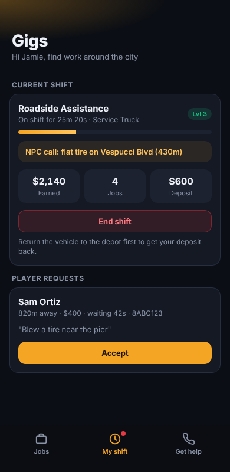

# bdev-civilian-jobs

Public civilian jobs for **Qbox (qbx_core)** FiveM servers. Anyone can work them: no whitelist, no job grade.

It's one **base resource** plus one **add-on resource per job**. Staff can turn each job on or off live. Players can hire each other for services (roadside help, locksmiths, ...), and an NPC steps in when nobody is working. The work is built around **minigames**, so it's more than driving from A to B.

| Resource | What it is |
|---|---|
| `bdev-civilian-jobs` | The base: Job Center, depots, rental vehicles and deposits, pay, XP and levels, player service requests with NPC fallback, ratings, the minigame kit, the **Gigs** phone app, and `/civjobs` on/off |
| `bdev-cj-roadside` | **Roadside Assistance**: flats, jump starts, fuel, coolant, engine, body and rollovers. Player call-outs plus NPC calls, and an NPC mechanic when nobody is on duty |
| `bdev-cj-locksmith` | **Locksmith**: car and house lockouts, lock changes, stuck safes and key cutting. Players call for a car lockout (ownership checked, keys go to the owner), a house lockout (qs-housing, lets the owner in) or a spare key. NPC locksmith when nobody is on duty |
| `bdev-cj-bus` | **Bus Driver**: timetabled routes unlocked by level, stopping on the mark, doors, NPC passengers who pay cash (make change) or show a pass (spot fakes), ride-quality rating. Real players can wait at a stop, ride, pay the fare and ring the bell |
| `bdev-cj-repo` | **Repo Agent**: NPC repossession cases. Search area, witnesses who may lie, a plate reader, slim jim + hotwire or strap to the flatbed, owners who show up to argue, pay up or fight |



## Requirements

- [qbx_core](https://github.com/Qbox-project/qbx_core), [ox_lib](https://github.com/overextended/ox_lib), [oxmysql](https://github.com/overextended/oxmysql), [ox_target](https://github.com/overextended/ox_target)
- Optional: `qs-smartphone` (Quasar Smartphone **V3**) for the Gigs app, `qbx_vehiclekeys`, ox_fuel statebag fuel. Keys and fuel can be swapped out in `bdev-civilian-jobs/config.lua` (`Config.GiveKeys`, `Config.SetFuel`).

## Install

1. Put this folder in your resources as a category, e.g. `resources/[civjobs]/`.
2. Add to `server.cfg`, **after** qbx_core, ox_lib, oxmysql, ox_target and qs-smartphone:
   ```
   ensure bdev-civilian-jobs
   ensure bdev-cj-roadside
   ensure bdev-cj-locksmith
   ensure bdev-cj-bus
   ensure bdev-cj-repo
   ```
   Leave out any job you don't want, or keep it installed and switch it off with `/civjobs`.
   Always start the base before the add-ons.
3. Start the server. The `civjobs_stats` table is created automatically (or run `bdev-civilian-jobs/sql/install.sql`).
4. Check the coordinates in each add-on's `config.lua` (depot, vehicle spawns, call spots) and adjust them to your map. `/civjobs pos` copies your position as a `vec4(...)`.

## Turning jobs on and off

| How | Example |
|---|---|
| Defaults | `bdev-civilian-jobs/config.lua` → `Config.Jobs = { roadside = true, ... }` (jobs not listed use `Config.DefaultEnabled`) |
| In game (admins) | `/civjobs` opens a menu: click a job to toggle it |
| Console / txAdmin | `civjobs list`, `civjobs enable roadside`, `civjobs disable roadside`, `civjobs reset [job]` |

In-game choices are saved (resource KVP) and override `config.lua` until you run `civjobs reset`. Turning a job off ends its shifts with a full deposit refund and refunds every open request for it. Stopping an add-on resource removes its job the same way.

## Players

| Command | What it does |
|---|---|
| `/jobs` | Job Center list: every job that's hiring, your level, and GPS to its depot |
| `/service` | Request a service (roadside, ...) without the phone, or check/cancel your request |
| `/jobqueue` | On-duty workers: see and accept open player requests |
| `/quitjob` | End your shift anywhere (the deposit only comes back if the vehicle is at the depot) |
| `/gigsapp` | Re-register the Gigs app with the phone and print the result in F8 |
| `/busroute` | Bus drivers: pick a route (also on the bus itself) |
| `/waitbus` or the bus stop target | Wait for a bus. Pay the fare when you sit down, ring the bell with **G** |
| `/repocase` | Repo agents: read the case file. Scan plates from the flatbed with **J** |

**Locksmith house lockouts** use qs-housing (`getCurrentHouse`, `GetPlayerHouses`, `enterHouse`). The adapter functions are in `bdev-cj-locksmith/config.lua` (`Config.Housing`) if you use another housing script. Car lockouts check `player_vehicles` ownership (`Config.OwnsVehicle`).

## How player requests work

1. A player requests a service from the Gigs app or `/service`. The price is taken and **held by the server**.
2. On-duty workers get a phone notification. The first to accept is sent to the player.
3. The worker does the job (minigames). The server checks it, then pays the held money to the worker, plus a job bonus (once per requester + worker pair every 30 minutes). The requester rates the worker.
4. **Nobody on duty**, or nobody accepts within `Config.Requests.npcAfter` (2 min): an NPC handles it for `npcPrice`. For roadside, an NPC mechanic drives out and fixes the car.
5. Cancelling before work starts refunds in full. Requests expire (and refund) after 15 minutes.

## Pay and anti-exploit

- All pay is calculated on the server. The client never sends an amount.
- Hourly cap per player per job (`Config.Limits.maxEarnPerHour`, overridable per job). Money from other players isn't capped.
- Level bonus: +3% per level (`Config.Levels`).
- Vehicle deposit is refunded by vehicle condition when returned to the depot.
- Repairs have a minimum time and server-side distance checks. The roadside diagnosis reads engine, body, fuel and roll on the server.

## Writing your own job

See [docs/ADDONS.md](docs/ADDONS.md). The minigames are documented in [docs/MINIGAMES.md](docs/MINIGAMES.md); open `bdev-civilian-jobs/html/minigame/index.html?game=nuts` in a browser to try one.
