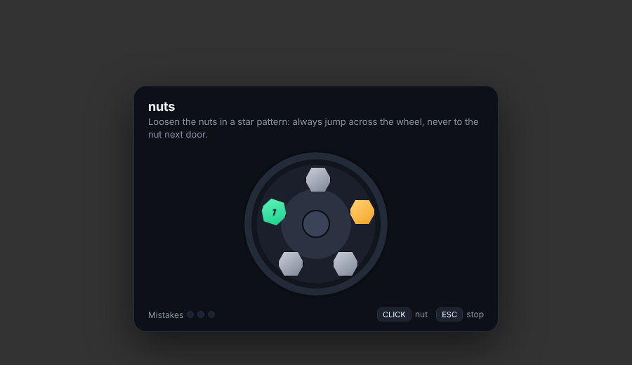
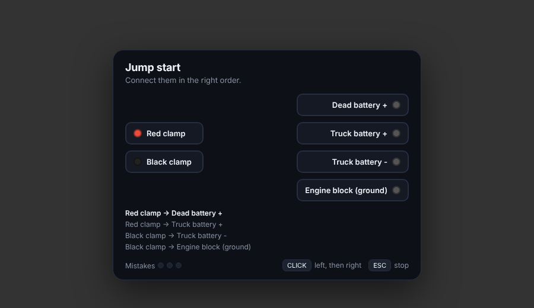
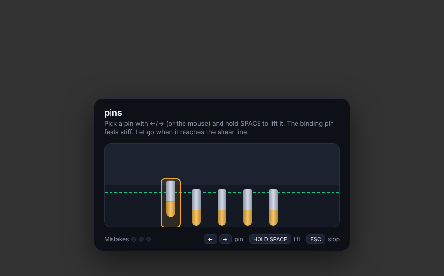
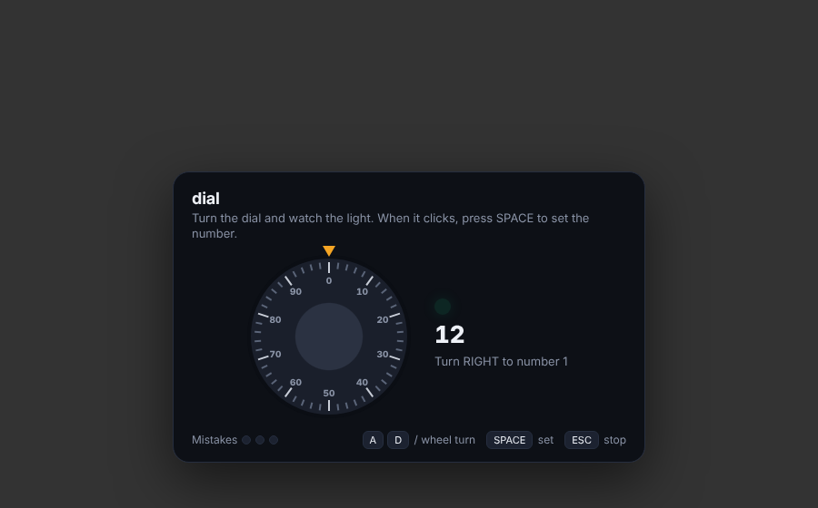
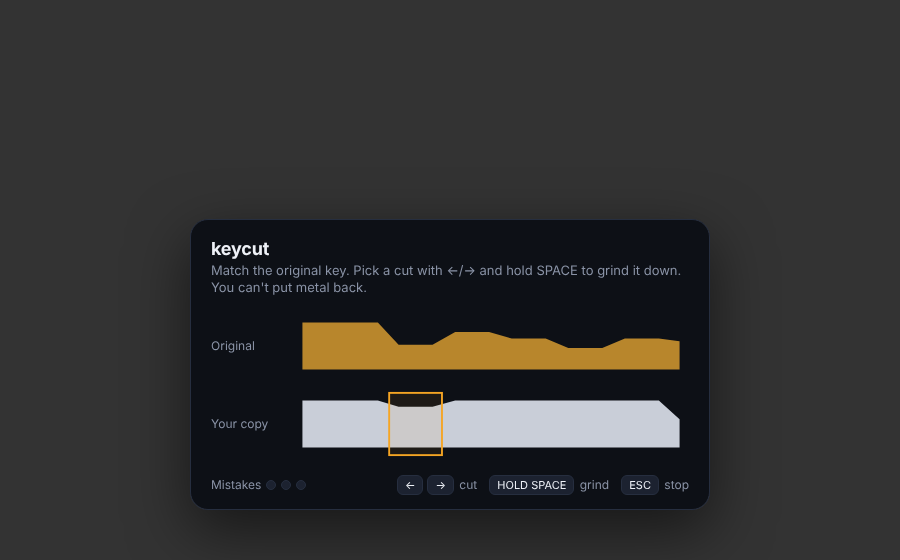
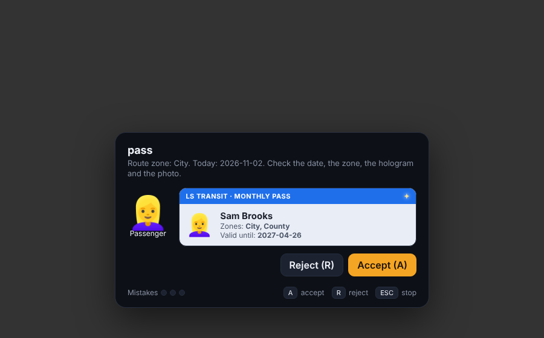
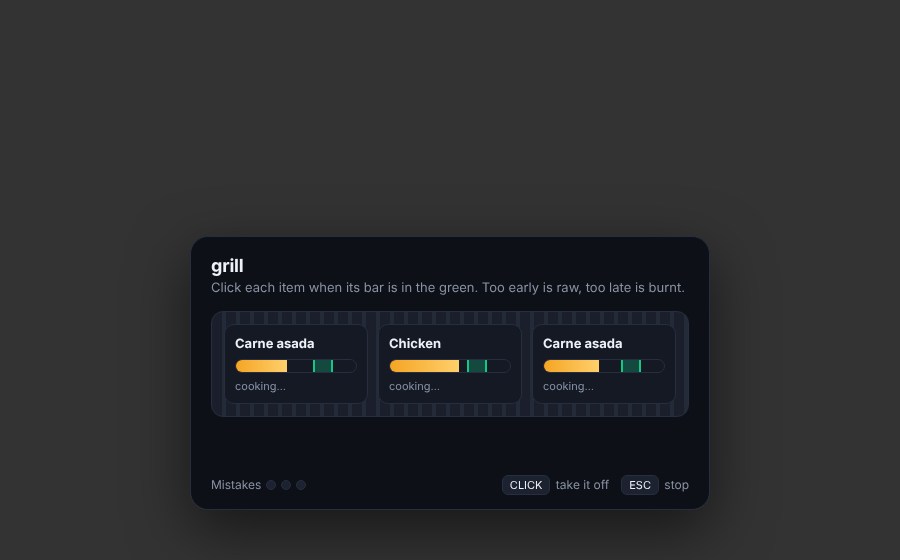

# Minigame kit

Any resource can run these:

```lua
local res = exports['bdev-civilian-jobs']:Minigame('torque', { title = 'Tighten the bolts', count = 4 })
-- add-ons can use CivJobs.minigame(name, opts)
if res.success then
    print(res.quality)   -- 0.0 - 1.0, use it for tips and ratings
end
-- res.mistakes, res.cancelled (ESC), res.timeout
```

**Common options:** `title`, `hint`, `difficulty` (0.0 easy to 1.0 hard, default 0.5), `misses` (mistakes allowed before failing, default 3), `time` (seconds, 0 = no timer).

The difficulty is eased by the player's level in the job they're working: `Config.Levels.minigameEase`, 4% per level by default.

| Game | Controls | Options | Used for |
|---|---|---|---|
| `pump` | SPACE when the needle is in the green | `hits` (5) | Raising the jack, pulling dents |
| `nuts` | Click the lug nuts in a star (criss-cross) pattern | `count` (4-8, default 5), `action` (`Loosen` / `Tighten`) | Wheel changes |
| `torque` | Hold SPACE, release inside the band | `count` (4) | Tightening bolts and wheels |
| `wiring` | Click a left item, then its right match | `mode = 'match'`: `count` (3-8). `mode = 'sequence'`: `clamps`, `terminals`, `order`; returns `shock = true` after a wrong connection | Wiring harness, jump starts |
| `pour` | Hold SPACE to pour, ENTER when done | `label`, `color` | Fuel, coolant |
| `tension` | Hold SPACE to winch, keep the needle in the green | `duration` (seconds in the green, default 6); returns `snapped = true` if it hit red | Winching cars upright |
| `pins` | ←/→ pick a pin, hold SPACE to lift, let go on the shear line. Only the binding pin sets, and it lifts stiffly; lifting it too far oversets it | `count` (3-7, default 5) | Locksmith doors, high-security car locks |
| `slimjim` | Click the gap in the window seal, steer the rod with the mouse to the lock rod, click to hook | `obstacles` (default 3-6 by difficulty) | Car lockouts, repo |
| `dial` | A/D or mouse wheel to turn (right, left, right…), SPACE when the light clicks | `numbers` (2-4, default 3) | Safes |
| `keycut` | ←/→ pick a cut, hold SPACE to grind it to match the original. Overcutting is a mistake | `cuts` (3-7, default 5) | Key copies, rekeying |
| `change` | Click bills/coins to give the right change, ENTER to hand it over | `fares` (list), `count` (1) | Bus fares |
| `grill` | Click each item when its bar is in the green. Too early is raw, too late is burnt and starts over | `items` (names, up to 6) | Food truck |
| `assemble` | Click the ingredients in the order on the ticket. On hard, the ticket flips over and you build from memory | `steps`, `extra` (distractors), `label` | Food truck |
| `pass` | Check a transit pass: date, zone, hologram, photo. A to accept, R to reject | `zone`, `today` (YYYY-MM-DD), `fakeChance` (0.35); returns `accepted` and `fake` | Bus passes |

Try one in a browser: open `bdev-civilian-jobs/html/minigame/index.html?game=wiring`.








